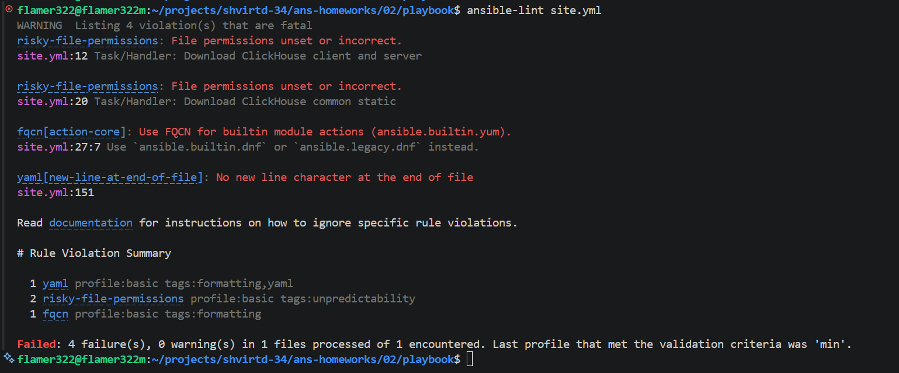
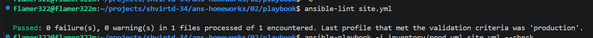
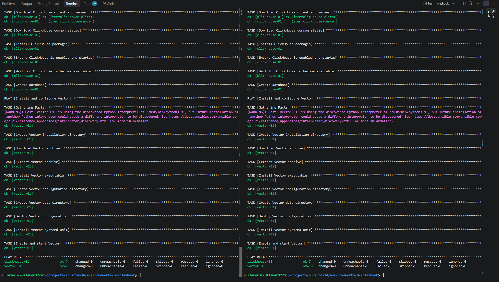

# Установка ClickHouse и Vector с помощью Ansible

Данный Ansible Playbook автоматизирует установку и настройку ClickHouse и Vector на удалённых серверах.

## Установка ClickHouse и Vector

Playbook позволяет:

- Устанавливать ClickHouse на удалённые Linux-серверы из RPM-пакетов.
- Создавать базу данных `logs` в ClickHouse.
- Устанавливать Vector из скачиваемого архива.
- Настраивать Vector с помощью шаблона Jinja2.
- Настраивать Vector в качестве службы systemd.
- Включать автоматический запуск обоих сервисов при загрузке системы.
- Проверять конфигурацию Vector перед её применением.
- Перезапускать сервисы при изменении конфигурации.

### Требования

- Установленный Ansible на управляющей машине.
- SSH-доступ к управляемым серверам.
- Установленный Python на управляемых серверах.
- Дистрибутив Linux с поддержкой `systemd`.
- Пакетный менеджер `dnf` на серверах ClickHouse.
- Root-доступ или права на выполнение команд через `sudo`.
- Доступ к сети для скачивания пакетов ClickHouse и архива Vector.

### Настройка

Укажите целевые серверы в inventory-файле. Playbook использует две группы хостов:

- `clickhouse` — серверы, на которых будет установлен ClickHouse.
- `vector` — серверы, на которых будет установлен и настроен Vector.

Пример inventory-файла `inventory/prod.yml`:

```yaml
all:
  children:
    clickhouse:
      hosts:
        clickhouse-01:
          ansible_host: 192.168.1.10
    vector:
      hosts:
        vector-01:
          ansible_host: 192.168.1.11
```

Замените IP-адреса на адреса ваших серверов.

Переменные, используемые в Playbook, необходимо определить в `group_vars` или в другом подходящем месте для хранения переменных Ansible.

Для ClickHouse используется следующая переменная:

- `clickhouse_version` — версия ClickHouse для установки.

Для Vector используются следующие переменные:

- `vector_download_url` — URL архива Vector.
- `vector_archive` — имя скачиваемого архива.
- `vector_install_dir` — каталог установки Vector.
- `vector_config_dir` — каталог конфигурации Vector.
- `vector_config_file` — путь к файлу конфигурации Vector.

Конфигурация Vector формируется на основе шаблона `templates/vector.toml.j2`.

Убедитесь, что в конфигурации Vector указан правильный адрес ClickHouse и используется база данных `logs`.

### Установка

Запустите Playbook из каталога, содержащего файл `site.yml`:

```bash
ansible-playbook -i inventory/prod.yml site.yml
```

Если для повышения привилегий требуется пароль, используйте:

```bash
ansible-playbook -i inventory/prod.yml site.yml --ask-become-pass
```

Для установки только ClickHouse выполните:

```bash
ansible-playbook -i inventory/prod.yml site.yml --limit clickhouse
```

Для установки только Vector выполните:

```bash
ansible-playbook -i inventory/prod.yml site.yml --limit vector
```

### Проверка установки

Проверьте состояние службы ClickHouse:

```bash
sudo systemctl status clickhouse-server
```

Убедитесь, что база данных `logs` создана:

```bash
clickhouse-client -q "SHOW DATABASES"
```

Проверьте состояние службы Vector:

```bash
sudo systemctl status vector
```

Проверьте корректность конфигурации Vector:

```bash
sudo /usr/local/bin/vector validate --config-dir /etc/vector
```

Просмотрите последние записи журнала Vector:

```bash
sudo journalctl -u vector -n 50 --no-pager
```

### Устранение неполадок

Если ClickHouse не запускается, проверьте его журналы:

```bash
sudo journalctl -u clickhouse-server -n 100 --no-pager
```

Если Vector не запускается, проверьте состояние службы и её журналы:

```bash
sudo systemctl status vector
sudo journalctl -u vector -n 100 --no-pager
```

Если проверка конфигурации Vector завершается ошибкой, проверьте файл `templates/vector.toml.j2` и убедитесь, что конфигурация соответствует установленной версии Vector.

Если Vector не может подключиться к ClickHouse, проверьте адрес сервера, порт, настройки базы данных, учётные данные и сетевую доступность ClickHouse с сервера Vector.

## Задания 5-8






