# Домашнее задание к занятию 5 «Тестирование roles»

## Ссылки

### [Ссылка на тег с решением задания Molecule](https://github.com/Flamer322/vector-role/releases/tag/v1.0.1)

### [Ссылка на тег с решением задания Tox](https://github.com/Flamer322/vector-role/releases/tag/v1.0.2)

## Задание Molecule

Запуск `molecule test -s ubuntu_xenial` в директории с ролью clickhouse

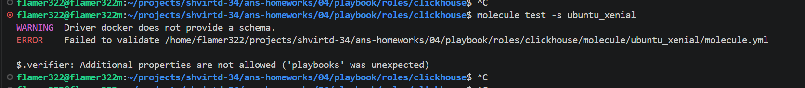

Повторный запуск после правки синтаксиса в `molecule.yml`

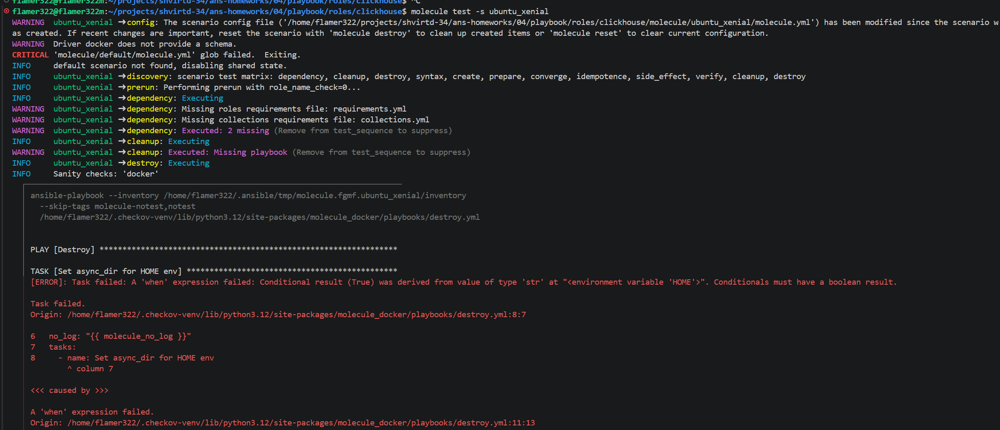

Dockerfile и `molecule.yml` для тестирования vector-role

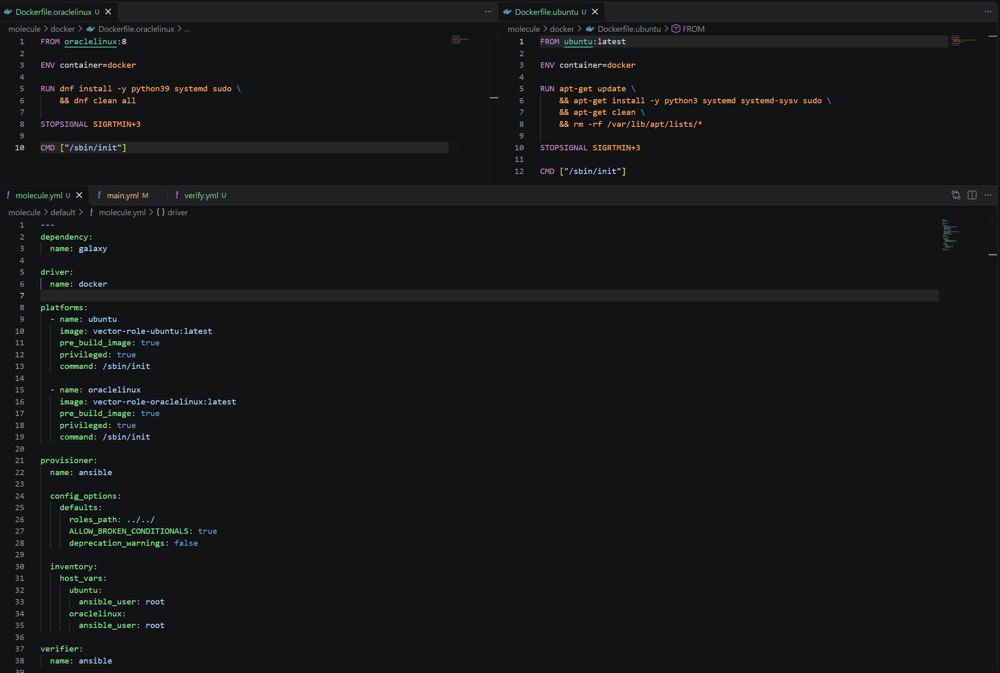

Выполнение роли в `converge.yml`

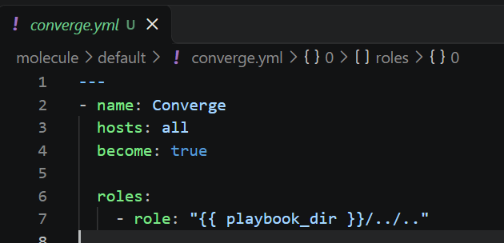

Исправление ошибок в tasks роли

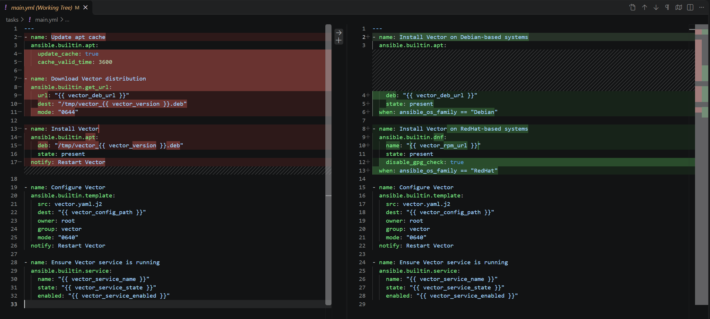

Успешное выполнение converge и idempotence

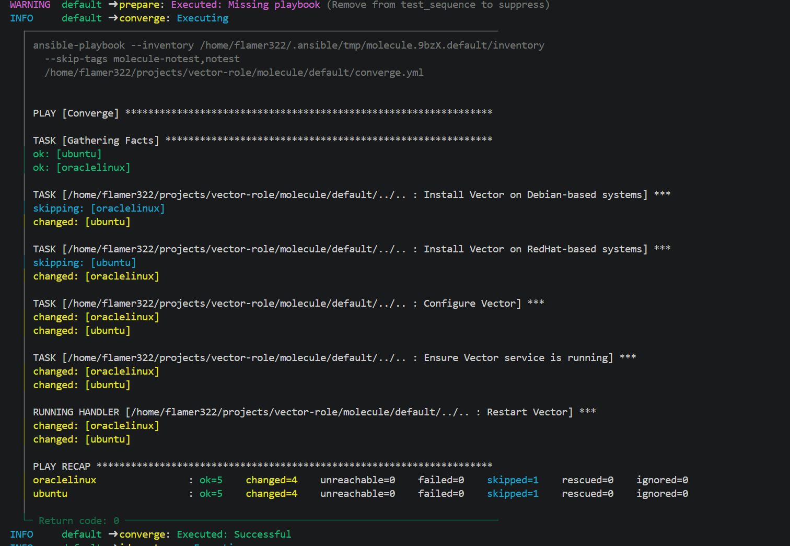
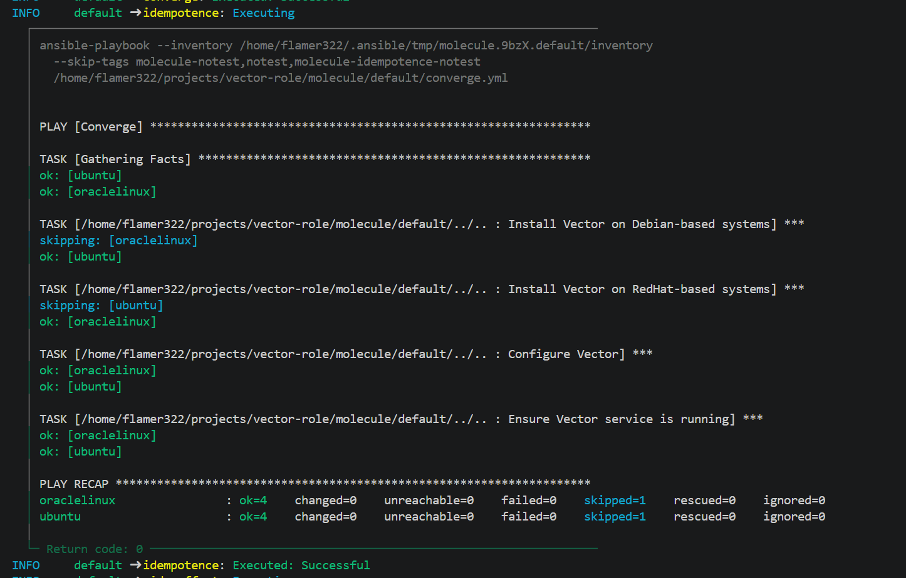

Добавленные проверки в `verify.yml`

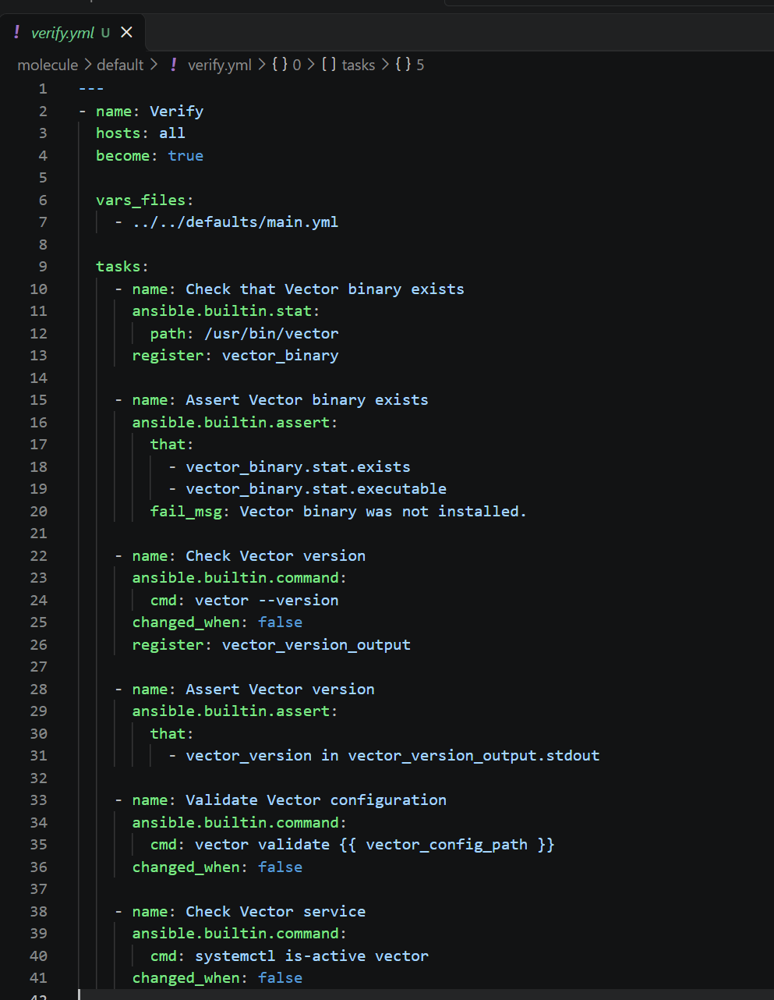

Успешное выполнение verify

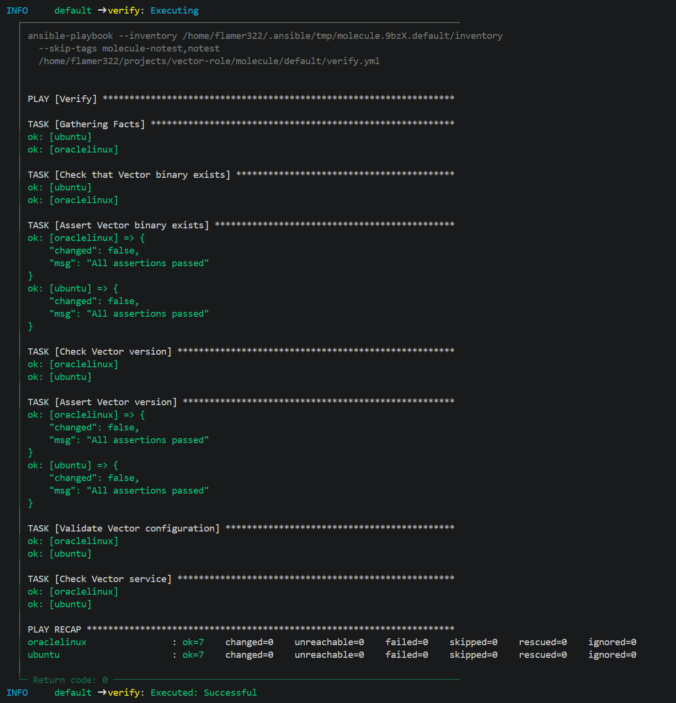

Результаты тестирования

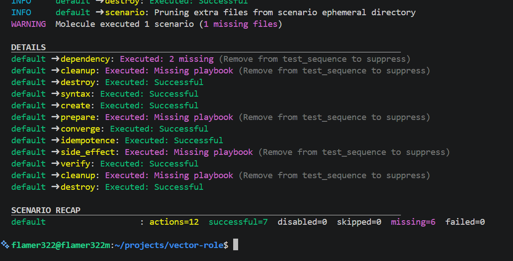

## Задание Tox

Первоначальный запуск `tox`

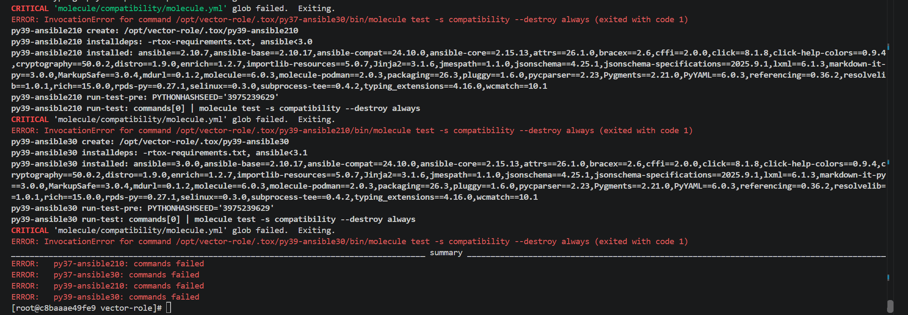

Конфигурация `prepare.yml` и `molecule.yml` для настройки контейнера и запуска облегчённого сценария

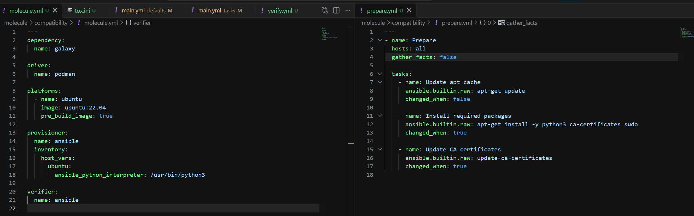

Выполнение роли в `converge.yml` и упрощённые проверки `verify.yml`

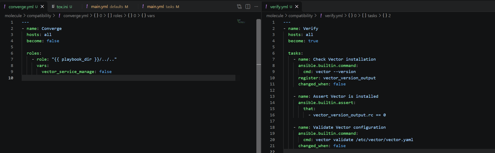

Исправление ошибок в tasks и handlers роли

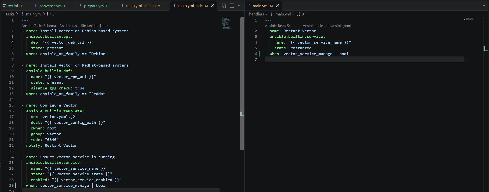

Фиксация конкретных зависимостей в `tox.ini` для успешной работы с python3.9

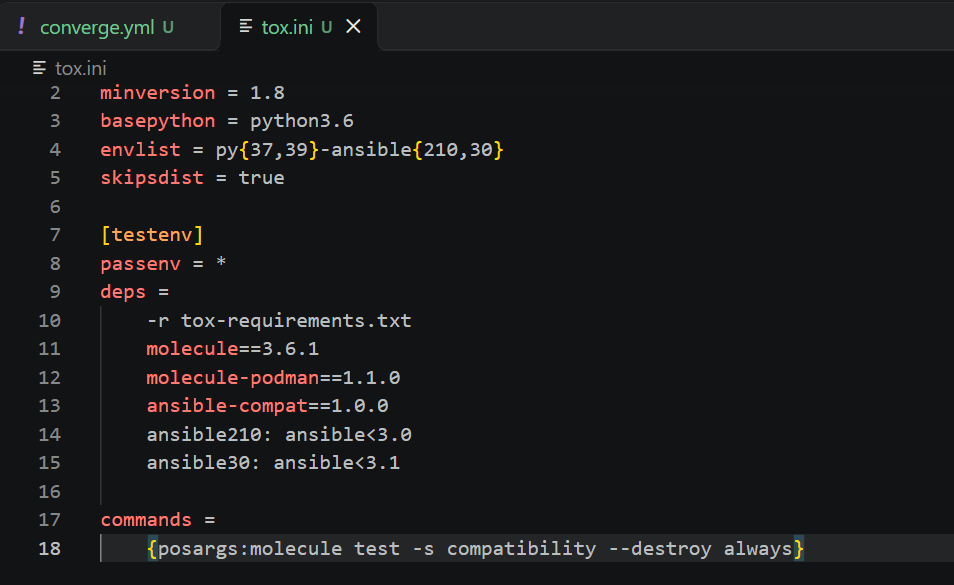

Результаты тестирования

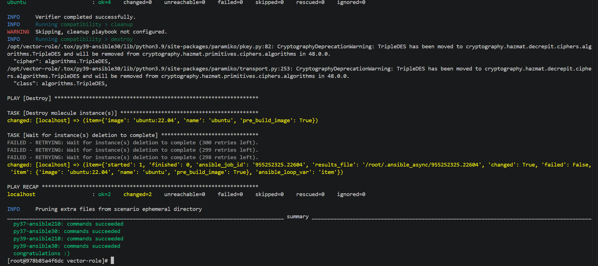

## Ссылки

### [Ссылка на тег с решением задания Molecule](https://github.com/Flamer322/vector-role/releases/tag/v1.0.1)

### [Ссылка на тег с решением задания Tox](https://github.com/Flamer322/vector-role/releases/tag/v1.0.2)
