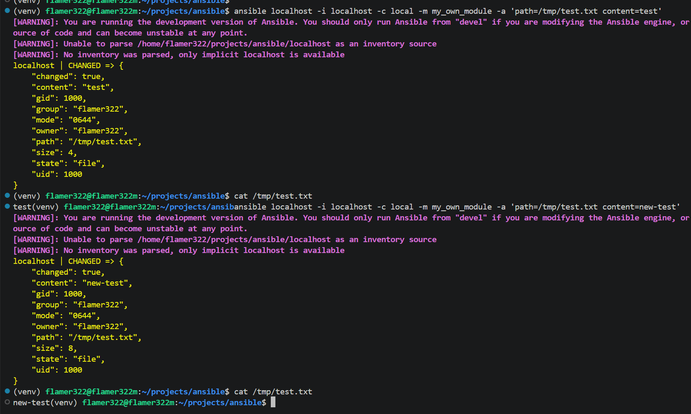
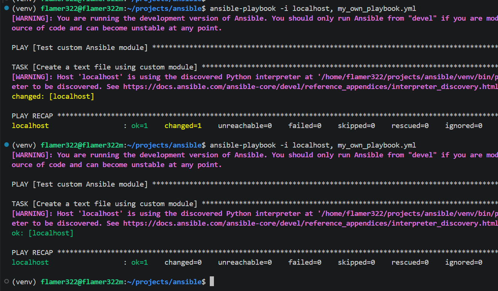
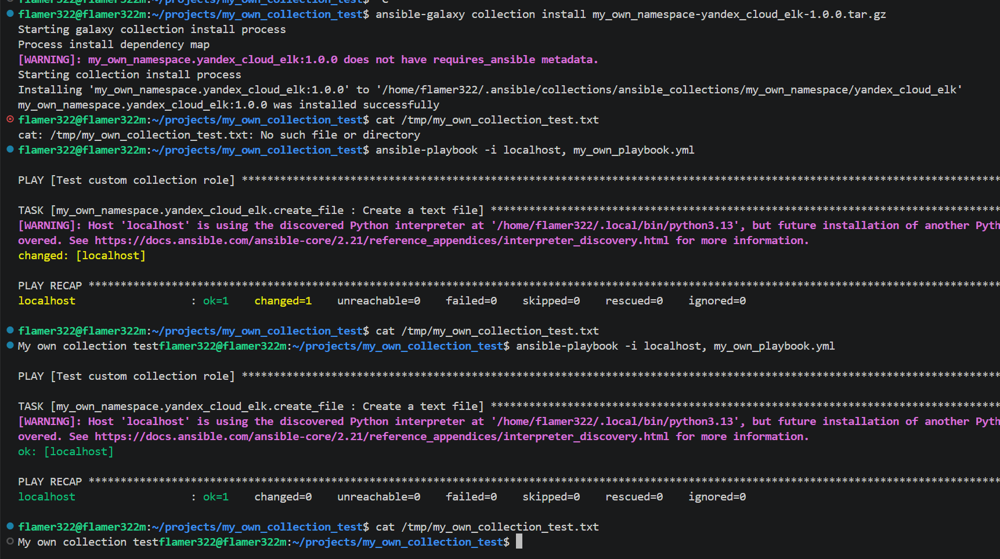

# Домашнее задание к занятию 6 «Создание собственных модулей»

## Ссылки

### [Ссылка на коллекцию](https://github.com/Flamer322/my_own_collection/tree/main/my_own_namespace/yandex_cloud_elk)

### [Ссылка на архив](https://github.com/Flamer322/my_own_collection/blob/main/my_own_namespace/yandex_cloud_elk/my_own_namespace-yandex_cloud_elk-1.0.0.tar.gz)

## Задание

Проверка локального запуска модуля

Проверка идемпотентности плейбука

Установка коллекции из архива и проверка работы плейбука

## Ссылки

### [Ссылка на коллекцию](https://github.com/Flamer322/my_own_collection/tree/main/my_own_namespace/yandex_cloud_elk)

### [Ссылка на архив](https://github.com/Flamer322/my_own_collection/blob/main/my_own_namespace/yandex_cloud_elk/my_own_namespace-yandex_cloud_elk-1.0.0.tar.gz)
