# Домашнее задание к занятию 11 «Teamcity»

### [Ссылка на репозиторий](https://github.com/Flamer322/example-teamcity)

## Задание

Первая сборка master

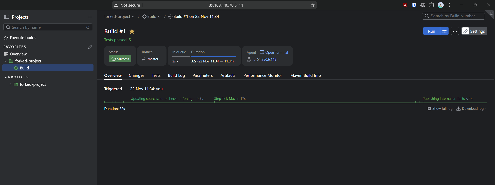

Отдельные шаги сборки для различных веток

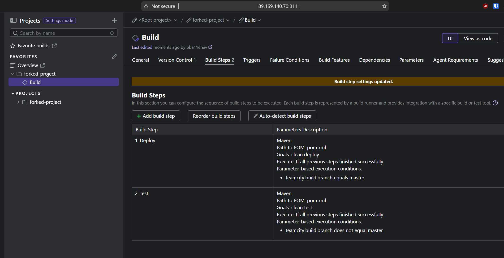

Добавленный `settings.xml` в сборке

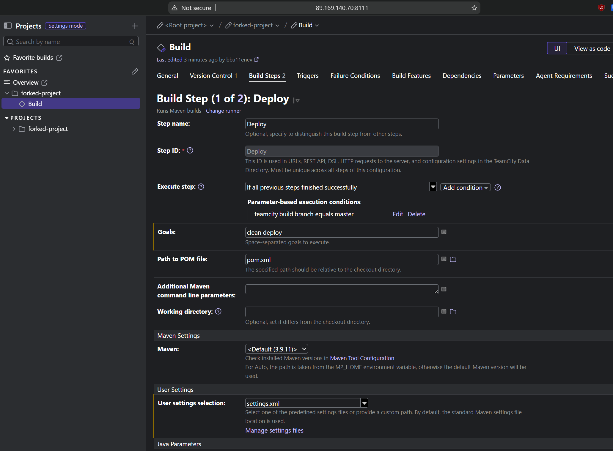

Изменения в `pom.xml`

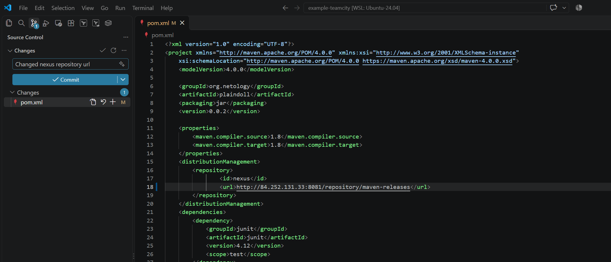

Очередная сборка и собранный артефакт

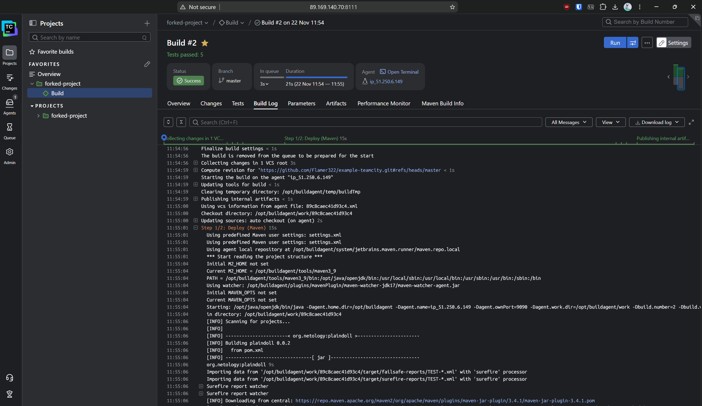
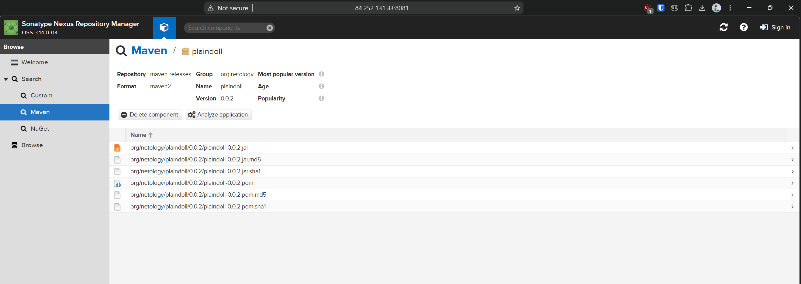

Включенное версионирование настроек

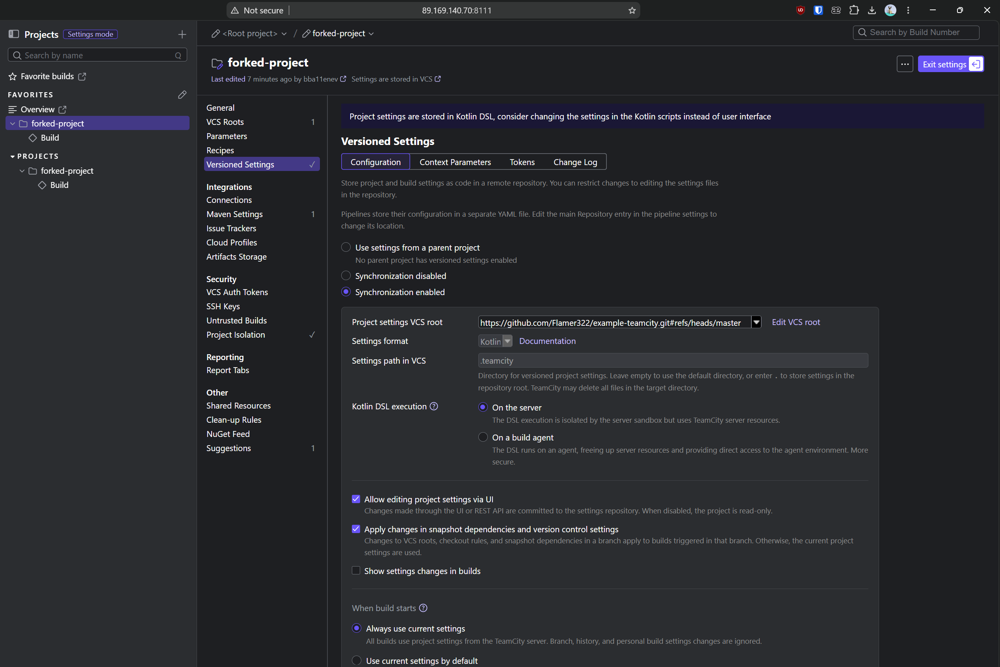

Изменения класса и теста Welcomer в проекте

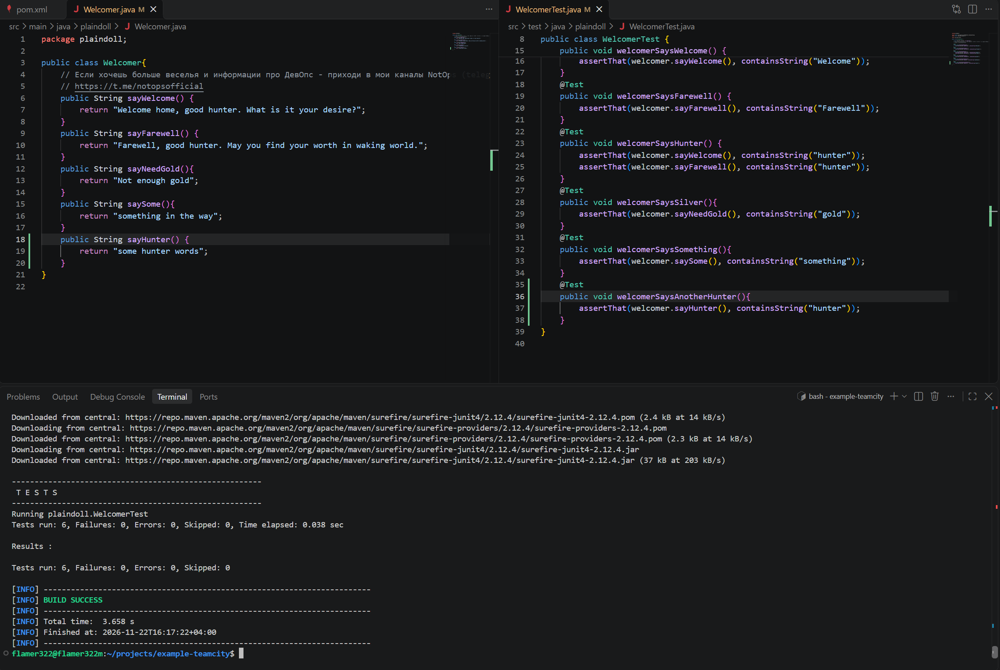

Триггер для автоматического запуска сборок и успешная сборка

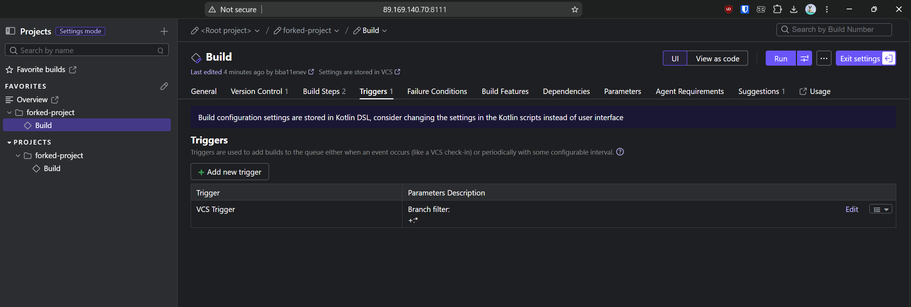
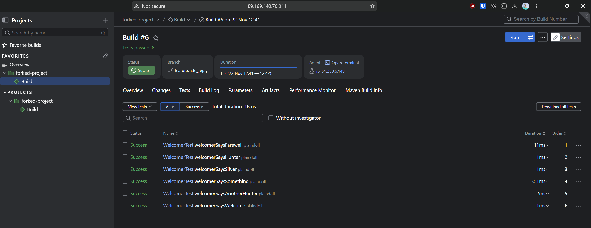

Результат сборки после merge

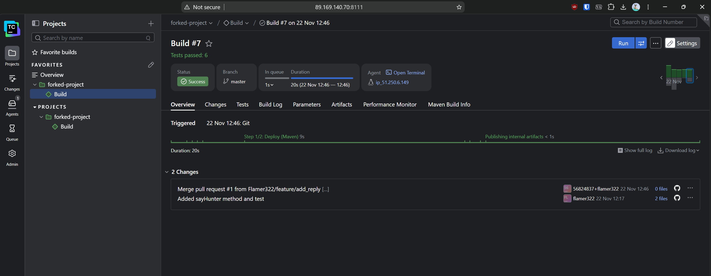

Отсутствие артефактов в результате сборки

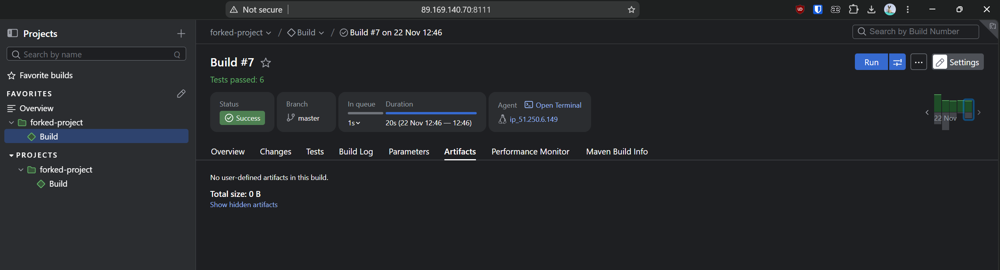

Настройка путей для сохранения артефактов

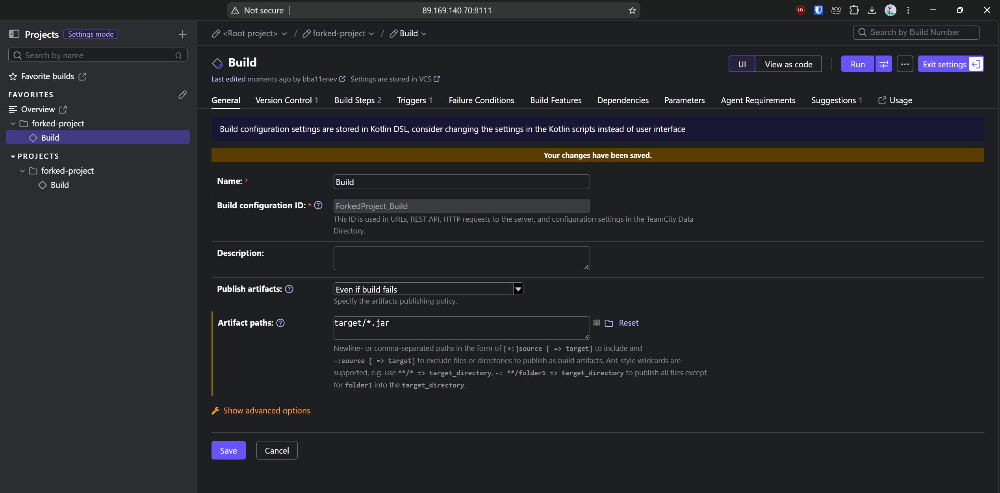

Успешная сборка и собранные артефакты

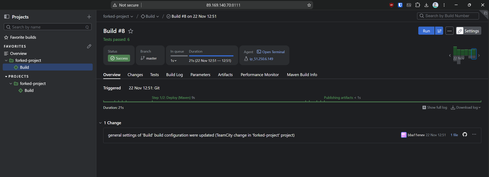
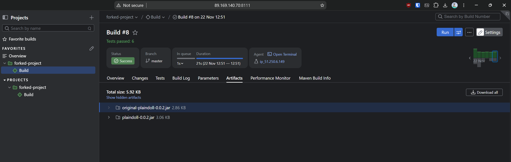

### [Ссылка на репозиторий](https://github.com/Flamer322/example-teamcity)
