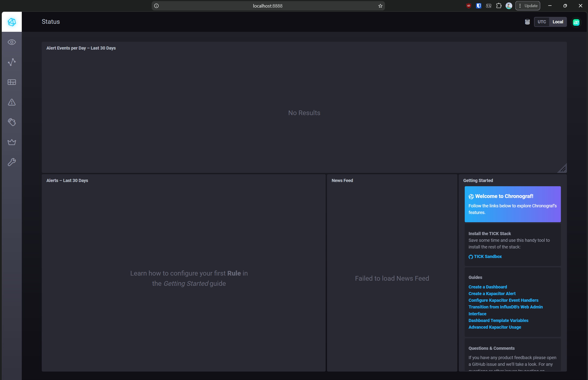
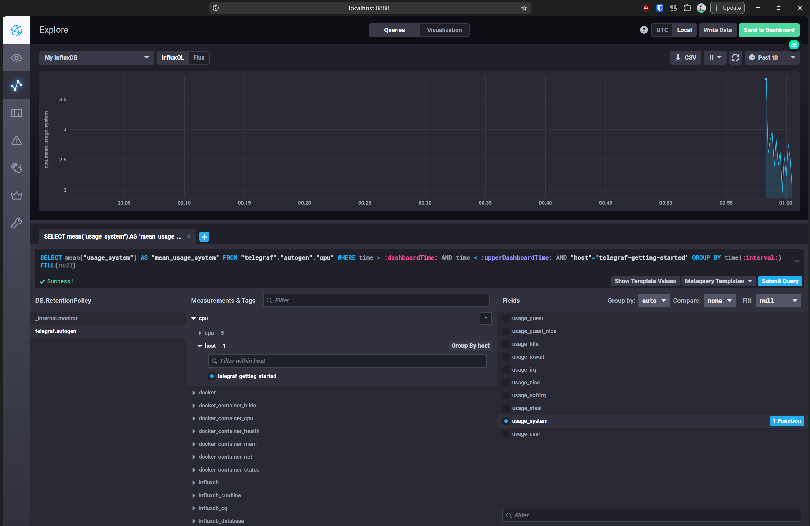
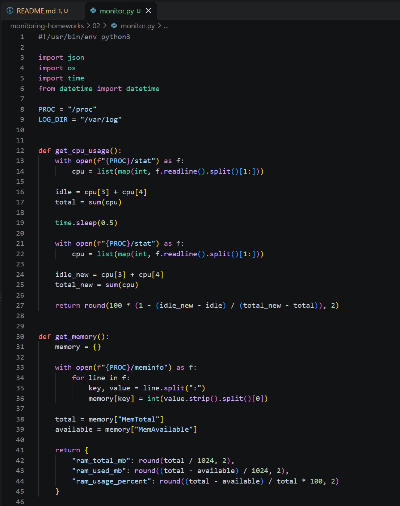
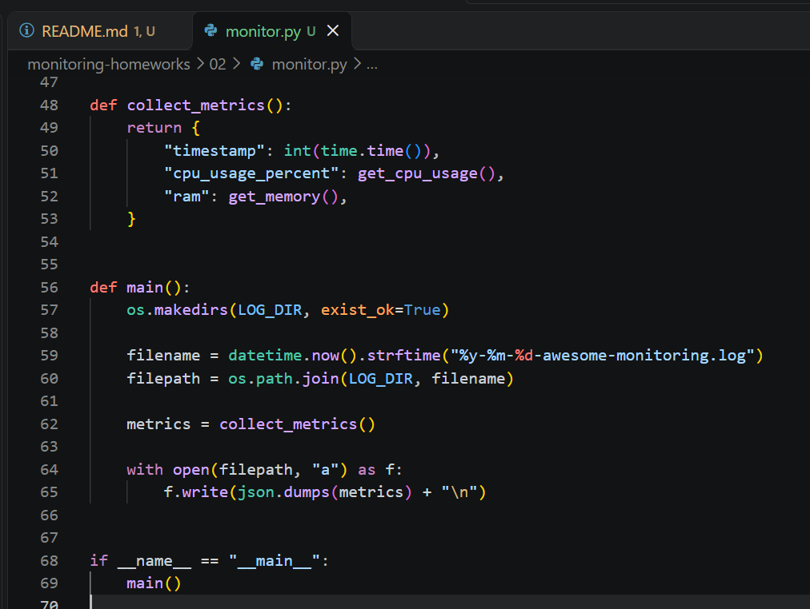
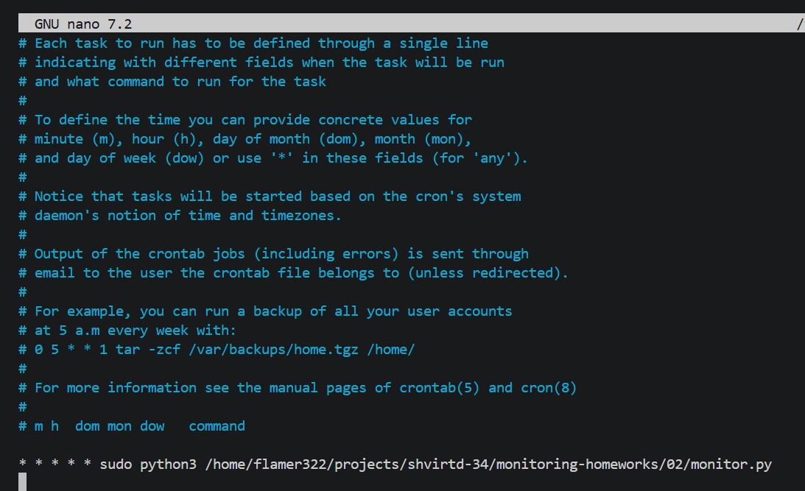
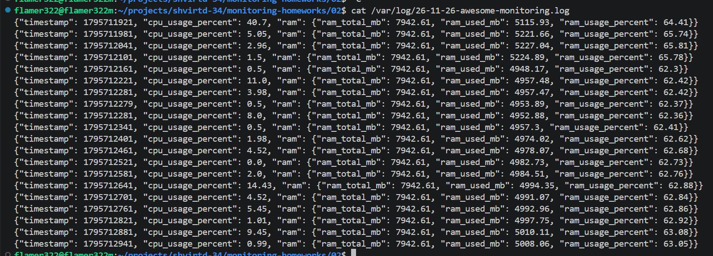
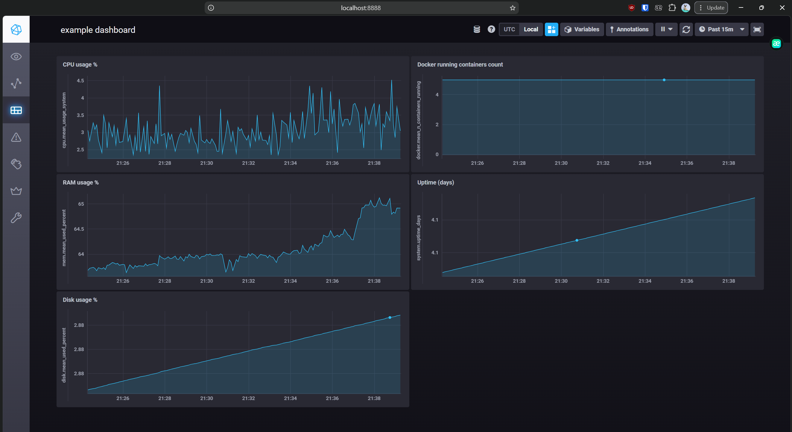

# Домашнее задание к занятию 13 «Системы мониторинга»

## Обязательные задания

### Задание 1

- CPU - загрузка процессора, так как вычисления загружают ЦПУ;
- RAM - использование оперативной памяти, если её будет не хватать для вычислений;
- Storage - использование места на диске, так как отчёты сохраняются на диск;
- Inodes - количество свободных inode, чтобы контроллировать возможность создания новых файлов;
- HTTP Requests - количество запросов, распределение по HTTP-кодам и время ответа;
- HTTP Errors - количество ошибок с HTTP-кодами 4xx и 5xx.

### Задание 2

Я бы предложил разнести метрики на отдельные дашборды:

- технические вроде RAM/inodes/CPUla - для инженеров команды;
- показатели SLA/SLO - для бизнес части команды.

### Задание 3

Настроить простейшую систему логов на уровне приложения для записи их в stdout/stderr, писать файлы логов, настроить почтовые уведомления

### Задание 4

3xx ответы могут быть успешными, если они подразумеваются в системе, так что правильнее считать (summ_2xx_requests + summ_3xx_requests)/summ_all_requests.  
4xx ответы так же как правило обозначают ошибки на клиентской стороне, так что возможно не означают ошибки системы.

### Задание 5

Push-модель:

- Плюсы:
  - упрощение репликации данных в разные системы мониторинга или их резервные копии;
  - более гибкая настройка отправки пакетов данных с метриками;
  - UDP — это менее затратный способ передачи данных, из-за чего может возрасти;
производительность сбора метрик
- Минусы:
  - сложнее контролировать доступность источников и гарантировать доставку метрик.

Pull-модель:

- Плюсы:
  - легче контролировать подлинность данных;
  - можно настроить единый proxy server до всех агентов с TLS;
  - упрощённая отладка получения данных с агентов;
- Минусы:
  - сервер мониторинга должен иметь доступ ко всем источникам.

### Задание 6

- Prometheus - pull
- TICK - push
- Zabbix - гибридная
- VictoriaMetrics - гибридная
- Nagios - pull

### Задание 7

Запущенный chronograf

### Задания 8-9

Метрика утилизации cpu, а также метрики docker в measurements

## Необязательные задания

### Задание 1

Код скрипта для сбора метрик cpu и ram

Код скрипта для записи временной метки и метрик в файл

Код скрипта - [main.tf](monitor.py)

Конфигурация crontab

Результирующий файл с метриками

### Задание 2

Дашборд с метриками

